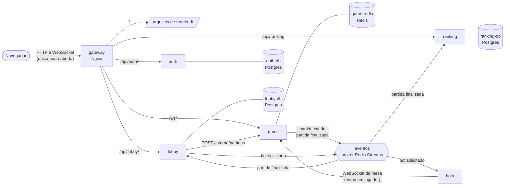

# Truco Online

Jogo de truco paulista online, com partidas 1x1 e 2x2 contra pessoas ou bots. Trabalho da disciplina Engenharia de Software (UFAL).

Requisitos completos, contratos das APIs e formato das mensagens: [documento de requisitos e contratos](https://claude.ai/code/artifact/37cda24d-3d94-4e3d-93b8-99790ba8252e).

## Visão geral

O sistema roda no navegador, sem instalar nada além do Docker no computador que o hospeda:

- **Conta:** cadastro e login. A sessão dura 24 horas.
- **Lobby:** lista de salas abertas, atualizada a cada 3 segundos. Cada pessoa cria uma sala 1x1 ou 2x2, escolhe o assento, chama os amigos pelo link da sala e completa as vagas com bots. Quem criou a sala inicia a partida.
- **Mesa:** truco paulista completo, com manilha pela vira, carta coberta, truco, seis, nove e doze, mão de onze e mão de ferro. Chat da mesa, animações (carta indo para a mesa, distribuição, pedido de truco, vencedor da rodada, placar e comemoração no fim) e reconexão automática se a conexão cair.
- **Bots:** um jogador automático que entra nas vagas de bot, joga com 1 a 2 segundos de "pensamento" e, no 2x2, deixa o truco e a mão de onze para o parceiro humano.
- **Ranking e histórico:** os 10 jogadores com mais vitórias e a sua posição, e o histórico de cada jogador, com as estatísticas e as últimas partidas.

## Stack

- Backend: Python com FastAPI
- Frontend: HTML, CSS e JavaScript puro
- Bancos: Postgres, uma instância por serviço que guarda usuários, salas e ranking (`auth-db`, `lobby-db`, `ranking-db`); Redis só do Game para o estado das partidas (`game-redis`)
- Eventos entre os serviços: outro Redis, o broker `eventos`, com Redis Streams
- Gateway: Nginx
- Tudo roda com Docker Compose

## Arquitetura

O sistema é dividido em microserviços. Cada serviço é um processo independente, num container próprio, com o seu diretório em `services/<nome>/`: código, `Dockerfile`, `requirements.txt` e testes. Nenhum serviço importa código de outro, e não há pacotes compartilhados entre eles.



- **O navegador só fala com o gateway.** O Nginx é o único container com porta aberta no computador. Ele entrega o frontend, repassa cada `/api/...` ao serviço certo e o `/ws/` (WebSocket da mesa) ao Game, sempre com o caminho inteiro (`/api/auth/login` chega ao Auth como `/api/auth/login`).
- **Um banco por serviço.** Cada serviço que guarda dados tem o próprio banco, num container próprio, com volume e credenciais próprios. Nenhum serviço conecta no banco de outro.
- **Dados e eventos ficam separados.** O `game-redis` guarda os dados do Game, e só o Game o acessa. O broker `eventos` é outro Redis, usado só para a comunicação entre os serviços (um stream por evento): o Game publica `partida.criada` e `partida.finalizada`; o Lobby lê `partida.finalizada` (encerra a sala) e publica `bot.solicitado`; o Ranking lê `partida.finalizada` (soma as vitórias); o Bots lê `bot.solicitado` (põe um bot na mesa). O formato dos eventos está no [guia da mesa](docs/guia-backend-mesa.md), seção 10.4, e no [guia do lobby](docs/guia-backend-lobby.md), seção 11.3.
- **Redes separadas.** Cada banco fica numa rede só com o seu serviço (`rede-auth-db`, `rede-lobby-db`, `rede-ranking-db`, `rede-game-redis`). O broker fica na `rede-eventos`, só com quem publica ou lê eventos (Game, Lobby, Ranking e Bots). O gateway e os serviços conversam na `rede-servicos`. O gateway não alcança nenhum banco nem o broker. O começo do `docker-compose.yml` explica essa organização.
- **Comunicação só pelas interfaces públicas:** HTTP, WebSocket e eventos. Cada serviço confere o token (JWT) sozinho, com o mesmo `JWT_SEGREDO`, sem chamar o Auth. As rotas internas entre serviços, como o `POST /interno/partidas` do Game, que o Lobby chama ao iniciar a partida, ficam fora do gateway.
- **Toda jogada é validada no Game.** O frontend só envia a intenção ("jogar carta X") e se redesenha a partir do estado que o Game manda. Nenhum jogador recebe as cartas dos outros.
- **O bot é um jogador como outro qualquer.** O serviço de Bots não importa código do Game: cada bot conecta ao WebSocket da mesa com um token que o próprio serviço assina, recebe só a visão dele do estado e envia as mesmas mensagens que a tela.
- **Animações da mesa** (`frontend/js/animacoes.js`): derivadas da comparação entre o estado anterior e o novo, sem regras do jogo e sem atrasar nenhum estado. Com o `prefers-reduced-motion` ligado no sistema, nada se move, só aparece com fades curtos.
- **O token não fica nos logs.** Ele vai na URL do WebSocket (o navegador não deixa pôr cabeçalhos numa conexão WebSocket), e o gateway e o Game o tiram das linhas de log (`gateway/nginx.conf` e `services/game/app/seguranca.py`).

### Serviços e containers

| Serviço | O que faz | Banco |
|---|---|---|
| `gateway` | Nginx. Serve o frontend e roteia `/api/auth/`, `/api/lobby/`, `/api/ranking` e `/ws/` | Nenhum |
| `auth` | Cadastro, login e emissão do JWT | `auth-db` (Postgres): os usuários |
| `lobby` | Salas 1x1 e 2x2, assentos, adição de bots, presença e início da partida | `lobby-db` (Postgres): as salas e os assentos |
| `game` | Regras do truco, estado da partida, WebSocket e chat da mesa | `game-redis` (Redis): o estado das partidas |
| `bots` | Jogador automático que se conecta ao Game como um cliente comum | Nenhum: os bots em jogo ficam guardados no próprio broker |
| `ranking` | Vitórias, partidas e histórico de cada jogador, a partir do evento `partida.finalizada` | `ranking-db` (Postgres): as partidas registradas e as vitórias de cada jogador |
| `eventos` | Broker de eventos (Redis Streams): `partida.criada`, `partida.finalizada` e `bot.solicitado` | Guarda só as mensagens em trânsito |

## Estrutura do repositório

```
truco-online/
├── docker-compose.yml   # todos os containers, as redes e os volumes
├── .env.example         # modelo do .env (configuração e segredos)
├── testes.sh            # roda os testes de todos os serviços num ambiente isolado
├── gateway/
│   └── nginx.conf
├── frontend/            # servido pelo gateway, sem build
│   ├── index.html       # login e cadastro
│   ├── lobby.html       # lista de salas, sala de espera e ranking
│   ├── mesa.html        # a mesa de jogo
│   ├── historico.html   # histórico de um jogador
│   ├── css/
│   ├── assets/          # cartas (SVG) e favicon
│   └── js/
│       ├── api.js       # chamadas HTTP aos serviços
│       ├── auth.js      # sessão (token no localStorage)
│       ├── ws.js        # conexão da mesa com o Game, com reconexão
│       ├── cartas.js    # imagem e manilha de cada carta
│       ├── animacoes.js # animações da mesa
│       └── paginas/     # um módulo por página
├── docs/                # guias do que o frontend espera de cada serviço e do que cada um decidiu
└── services/
    ├── auth/
    │   ├── app/         # FastAPI: rotas, banco, senha e JWT
    │   └── tests/       # pytest
    ├── lobby/
    │   ├── app/         # FastAPI: rotas e regras das salas, banco, chamada ao Game e eventos
    │   └── tests/       # pytest, com um Game falso
    ├── game/
    │   ├── engine/      # motor de regras em Python puro, sem FastAPI, Redis nem I/O
    │   ├── app/         # FastAPI: WebSocket da mesa, rota interna, Redis e eventos
    │   ├── scripts/     # partida_de_teste.py: cria uma partida sem o Lobby
    │   └── tests/       # pytest: engine/ (motor) e app/ (serviço)
    ├── bots/
    │   ├── app/         # leitura do bot.solicitado, conexão com a mesa e a estratégia do bot
    │   └── tests/       # pytest: estrategia/ (sem rede) e servico/ (com os serviços no ar)
    └── ranking/
        ├── app/         # FastAPI: ranking, histórico, banco e leitura do partida.finalizada
        └── tests/       # pytest
```

## Como rodar

Precisa do Docker com o Docker Compose v2 (`docker compose version`).

### 1. Configure o `.env`

Crie o `.env` a partir do modelo e troque os valores de exemplo:

```bash
cp .env.example .env
```

| Variável | Para quê |
|---|---|
| `GATEWAY_PORTA` | Porta do computador em que o sistema atende. Padrão: `80`. Se ela estiver ocupada, use outra, como `8080`. |
| `JWT_SEGREDO` | Segredo que assina os tokens, o mesmo para todos os serviços. Mínimo de 32 caracteres. Para gerar: `python3 -c "import secrets; print(secrets.token_hex(32))"` |
| `AUTH_DB_NOME`, `AUTH_DB_USUARIO`, `AUTH_DB_SENHA` | Nome, usuário e senha do banco do Auth (`auth-db`). |
| `LOBBY_DB_NOME`, `LOBBY_DB_USUARIO`, `LOBBY_DB_SENHA` | Nome, usuário e senha do banco do Lobby (`lobby-db`). |
| `RANKING_DB_NOME`, `RANKING_DB_USUARIO`, `RANKING_DB_SENHA` | Nome, usuário e senha do banco do Ranking (`ranking-db`). |
| `GAME_REDIS_SENHA` | Senha do Redis do Game (`game-redis`). |
| `EVENTOS_SENHA` | Senha do broker de eventos. Todos os serviços que publicam ou leem eventos usam a mesma. |
| `BOTS_SEMENTE` | Opcional. Semente do sorteio dos bots: com ela, o mesmo bot repete as mesmas escolhas nas mesmas situações. Sem ela, cada partida é diferente. |

Para gerar uma senha: `python3 -c "import secrets; print(secrets.token_hex(16))"`.

- O `.env` não vai para o repositório (está no `.gitignore`). Sem ele, ou sem uma variável obrigatória, o Docker Compose para com uma mensagem dizendo qual falta.
- O usuário e a senha de cada Postgres ficam gravados no volume na primeira vez que ele sobe. Se você trocar `AUTH_DB_*`, `LOBBY_DB_*` ou `RANKING_DB_*` depois disso, o serviço não consegue mais entrar no banco: rode `docker compose down -v` para recomeçar com os valores novos (apaga os dados de todos). As senhas dos dois Redis não ficam no volume: uma troca em `GAME_REDIS_SENHA` ou `EVENTOS_SENHA` vale no próximo `docker compose up -d`.

### 2. Suba tudo

```bash
docker compose up --build -d
```

Espere o `docker compose ps` mostrar os serviços e os bancos como `healthy` (uns 30 segundos na primeira vez, depois do build).

### 3. Acesse

Abra `http://localhost` (ou `http://localhost:<GATEWAY_PORTA>`).

### Comandos do dia a dia

| Comando | O que faz |
|---|---|
| `docker compose up --build -d` | Sobe em segundo plano, com o código atual |
| `docker compose ps` | Mostra os containers; os serviços e os bancos ficam `healthy` quando estão prontos |
| `docker compose logs -f lobby` | Acompanha o log de um serviço |
| `docker compose down` | Para e remove os containers. Os usuários, as salas, as partidas, o ranking e os eventos continuam nos volumes |
| `docker compose down -v` | Para e **apaga também os volumes** (veja [Limpar os dados](#limpar-os-dados)) |

- Mudanças em `frontend/` valem no próximo F5: o gateway lê os arquivos direto da pasta. Mudanças no `gateway/nginx.conf` pedem `docker compose restart gateway`, e mudanças no código de um serviço, `docker compose up --build -d`.
- As páginas de testes do FastAPI (o `/docs`) abrem pelo gateway: `http://localhost/api/auth/docs`, `http://localhost/api/lobby/docs` e `http://localhost/api/ranking/docs`. A do Game fica em `/interno/docs`, fora do gateway.
- Para olhar dentro dos Redis: `docker compose exec game-redis redis-cli --scan --pattern 'partida:*'` lista as partidas; `docker compose exec eventos redis-cli XRANGE partida.finalizada - +` mostra os eventos de fim de partida, `XRANGE bot.solicitado - +`, os pedidos de bot, e `XPENDING bot.solicitado bots`, quantos bots estão em jogo (os pedidos que o serviço de Bots ainda não confirmou).
- Para olhar dentro dos Postgres: `docker compose exec lobby-db sh -c 'psql -U "$POSTGRES_USER" "$POSTGRES_DB"'` (troque por `ranking-db` ou `auth-db`).

### Limpar os dados

```bash
docker compose down -v
```

Apaga os containers e os cinco volumes: usuários, salas, partidas, ranking e eventos. No próximo `docker compose up --build -d`, o sistema começa vazio, e cada serviço cria as suas tabelas sozinho.

Quem estava logado no navegador continua com o token guardado, mas o usuário dele não existe mais: ao abrir o lobby, a tela volta para o login com "Sua sessão expirou. Entre novamente.". Basta criar a conta de novo.

## Como jogar

### Dois navegadores

O fluxo normal é todo pela tela, com os serviços de verdade: cadastro, sala, partida e ranking.

1. Suba tudo (`docker compose up --build -d`) e espere o `docker compose ps` mostrar os serviços `healthy`.
2. Abra `http://localhost/` e crie uma conta, na aba "Criar conta". O cadastro já entra e abre o lobby.
3. Abra `http://127.0.0.1/` em outra aba e crie outra conta. **Para o navegador, `localhost` e `127.0.0.1` são sites diferentes: cada um guarda a sua sessão** (o token fica no `localStorage`, que é separado por endereço). Assim os dois jogadores cabem no mesmo navegador, em abas separadas. Já duas abas no mesmo endereço são o mesmo jogador. Uma janela anônima ou outro navegador também valem como outra sessão. Com outra `GATEWAY_PORTA`, use `http://localhost:8080/` e `http://127.0.0.1:8080/`.
4. Na aba de `localhost`, clique em "Criar sala 1x1". Na de `127.0.0.1`, a sala aparece na lista em até 3 segundos: clique em "Entrar".
5. Quem criou a sala (o dono) clica em "Iniciar partida". Os dois vão para a mesa: o dono na hora, o outro em até 3 segundos.
6. Joguem até um time chegar a 12 pontos. Na tela de fim de partida, cliquem em "Voltar ao lobby".
7. O painel do ranking, à direita, mostra os dois com as vitórias e as partidas atualizadas. "Meu histórico", no cabeçalho, e o nome de cada jogador no ranking abrem o histórico com as últimas partidas. A sala saiu da lista, e os dois já podem criar ou entrar em outra.

Outros casos para conferir:

- **2x2 com quatro pessoas:** são quatro sessões, por exemplo `localhost` e `127.0.0.1` numa janela normal e de novo numa janela anônima. A partida começa com os quatro na mesa, parceiros frente a frente.
- **Link de convite:** o endereço da sala (`lobby.html?sala=...`) mostra a sala a quem não está nela, que escolhe uma vaga.
- **Presença:** quem fecha a aba da sala de espera sai da sala depois de 60 segundos; se for o dono, a sala é encerrada.
- **Queda e F5:** um F5 na mesa, ou a conexão caindo, volta para a mesma partida, no ponto em que ela estava.

### Contra bots

1. Abra `http://localhost/` e entre (ou crie uma conta).
2. Clique em "Criar sala 1x1". Na vaga do assento 1, clique em "Adicionar bot": entra o "Bot 1", com o selo "BOT".
3. Clique em "Iniciar partida". Na mesa, o bot joga sozinho, esperando de 1 a 2 segundos antes de cada jogada: joga as cartas, pede truco, responde e decide a mão de onze.
4. Jogue até um time chegar a 12 e clique em "Voltar ao lobby". O ranking mostra a sua partida; o bot não entra no ranking (ele aparece só no histórico da partida).

No 2x2, ponha bots nas outras três vagas: o do assento 2, seu parceiro, deixa para você responder ao truco e decidir a mão de onze (vale a primeira resposta do time); no time adversário, quem responde é o bot do assento 1.

Para acompanhar os bots: `docker compose logs -f bots` mostra cada bot que entra numa partida, as quedas de conexão e a saída no fim, com quantas ações ele fez. Para ver o bot voltar sozinho depois de um reinício, rode `docker compose restart bots` no meio de uma partida: a vez dele fica parada uns segundos, e ele volta de onde parou.

### Uma partida sem passar pelo Lobby

O script de desenvolvimento do Game cria uma partida 1x1 direto na rota interna `POST /interno/partidas`, a mesma que o Lobby chama:

```bash
docker compose exec game python scripts/partida_de_teste.py
```

Se o gateway estiver em outra porta, passe a `GATEWAY_PORTA`: `docker compose exec game python scripts/partida_de_teste.py --porta 8080`.

Ele cadastra (ou só faz o login de) dois usuários de teste no Auth, pelo gateway: `ana.teste@truco.dev` e `beto.teste@truco.dev`, os dois com a senha `truco123`. Depois cria a partida e imprime o que abrir para cada jogador: a Ana em `http://localhost/`, o Beto em `http://127.0.0.1/`. Como é uma partida de verdade entre dois usuários, ela conta no ranking quando termina; como não tem sala, o Lobby não muda nada.

## Testes

Os testes de todos os serviços rodam num ambiente isolado: um projeto separado do Docker Compose, `truco-testes`, com containers, redes e **volumes próprios**. Os usuários, as salas, as partidas e o ranking de quem usa o sistema não são tocados, e o sistema pode continuar no ar enquanto os testes rodam (o ambiente de testes não sobe o gateway e não ocupa nenhuma porta do computador).

```bash
./testes.sh              # todas as suítes: auth, game, lobby, ranking e bots
./testes.sh game bots    # só as indicadas
```

O script sobe o ambiente com o código atual (`--build`), roda o `pytest` de cada serviço dentro do container dele e, no fim, apaga o ambiente com os volumes, passando ou não. Leva uns 3 minutos depois do build; a maior parte são as partidas dos testes dos Bots. A saída termina em "Todas as suítes passaram" ou com a lista das que falharam (e o script sai com erro).

Sem o bash (no PowerShell, por exemplo), os mesmos passos, a partir da raiz do repositório:

```bash
docker compose -p truco-testes up -d --build --wait auth game lobby ranking bots
docker compose -p truco-testes run --rm --no-deps auth pytest
docker compose -p truco-testes run --rm --no-deps game pytest
docker compose -p truco-testes run --rm --no-deps lobby pytest
docker compose -p truco-testes run --rm --no-deps ranking pytest
docker compose -p truco-testes run --rm --no-deps bots pytest
docker compose -p truco-testes down -v
```

O `-p truco-testes` é o que isola: sem ele, os comandos valem para o sistema em uso. Os testes de serviço dos Bots conferem isso e se recusam a rodar no projeto `truco-online`.

O que cada suíte cobre:

- **auth:** cadastro, login, `GET /api/auth/me`, os erros no formato do contrato e o `/saude`.
- **game:** `tests/engine`, o motor de regras: cartas e manilhas, empates, carta coberta, truco, mão de onze, mão de ferro, a carta vencedora de cada rodada, a visão de cada jogador e partidas completas simuladas em 1x1 e 2x2 (roda também fora do Docker, só com o `pytest`: `pytest tests/engine`, dentro de `services/game`). `tests/app`, a camada de serviço com os dois Redis: a rota interna, os eventos (inclusive com o broker fora do ar), o WebSocket com os fechamentos 4401, 4403, 4404 e 4409, a reconexão, a pausa entre as mãos, o fim da partida e o token fora do log.
- **lobby:** as rotas e a ordem dos erros, as travas com pedidos ao mesmo tempo, a presença, o início da partida com um Game falso (fora do ar, lento ou respondendo errado), a entrega do `bot.solicitado` com o broker fora do ar e a leitura do `partida.finalizada` (repetido, fora do formato, com o serviço parado).
- **ranking:** o ranking com empates, o histórico do jogador e a leitura do `partida.finalizada`, inclusive publicado antes de o serviço existir.
- **bots:** `tests/estrategia`, a estratégia do bot, sem rede (roda também fora do Docker: `pytest tests/estrategia`, dentro de `services/bots`). `tests/servico`, com os serviços no ar: uma partida 1x1 de uma pessoa contra um bot e uma 2x2 de uma pessoa com três bots, criadas pelo Lobby e jogadas até o fim pelo container `bots`; o serviço caindo no meio de uma partida, com o bot voltando a jogar; e o mesmo pedido de bot chegando várias vezes sem criar outro bot.

Dentro do ambiente de testes, cada suíte ainda usa bancos próprios: `auth_teste`, `lobby_teste` e `ranking_teste` nos Postgres e bancos lógicos separados nos Redis (1 no Game, 2 no Lobby, 3 no Ranking e 4 nos Bots). Detalhes no [guia da mesa](docs/guia-backend-mesa.md), seção 10.7, e no [guia do lobby](docs/guia-backend-lobby.md), seção 11.6.

## Limitações conhecidas

- **Um processo por serviço.** O Game guarda as conexões da mesa e as travas de cada partida na memória do processo; Lobby, Ranking e Bots leem os eventos com um nome fixo de consumidor (`lobby-1`, `ranking-1`, `bots-1`), para reler o que tinha ficado sem confirmar depois de um reinício. Por isso cada serviço roda sem `--workers` e com um container só. O estado das partidas fica no `game-redis` e sobrevive a um reinício do Game, e a mesa reconecta sozinha. Explicação completa em `services/game/app/partidas.py`.
- **Partida órfã quando o Game demora a responder ao Lobby.** Se o Game criar a partida e a resposta não chegar ao Lobby em 5 segundos, o dono vê "Não foi possível iniciar a partida agora" e a sala continua aguardando; pode tentar de novo. A partida que o Game chegou a criar fica sem ninguém e é apagada depois de 7 dias parada.
- **Jogador desconectado sem indicador.** Quem cai ou fecha a aba não é substituído: a partida espera ele voltar, sem prazo e sem bot no lugar (decisão do grupo). A mesa dos outros não mostra quem está desconectado; eles só veem a vez parada.
- **Bots só no nível `"padrao"`.** O Lobby recusa outro nível, e um nível novo precisa entrar no Lobby e no serviço de Bots. O bot de uma partida que a pessoa abandonou fica conectado esperando, como a partida.
- **Mão de ferro sem cartas às cegas.** Com 11 a 11, a mão é jogada com as cartas à vista, valendo 1 e sem truco (decisão do grupo); quem vencer chega a 12.
- **Partidas paradas.** Uma partida sem nenhuma mudança por 7 dias é apagada do `game-redis`; o link dela passa a mostrar "Esta partida não existe.".
- **Logout só no navegador.** Sair apaga o token do navegador, mas não existe rota de logout: o token continua valendo até vencer (24 horas).
- **Nomes repetidos.** O nome não precisa ser único (até 20 caracteres, cortado com reticências quando não cabe na tela) e não pode ser trocado depois do cadastro. Dois jogadores com o mesmo nome na mesma mesa se confundem no chat, que identifica o autor pelo nome.
- **Sem HTTPS.** O gateway atende só HTTP: em outra máquina da rede, a senha e o token passam sem criptografia (o Firefox avisa isso no console da tela de login). O log de erros do Nginx, quando o Game está fora do ar, registra o pedido do WebSocket com o token.
- **Tempo limite da tela.** A tela desiste de uma requisição depois de 10 segundos. Um cadastro que demore mais pode criar a conta e mostrar falha de conexão; na nova tentativa, aparece "e-mail já cadastrado", e basta entrar.

## Documentação

- [Guia do login](docs/guia-backend-login.md): o serviço Auth, as rotas, os erros, as senhas e o JWT.
- [Guia do lobby](docs/guia-backend-lobby.md): os serviços Lobby e Ranking, as regras das salas, os eventos e o histórico.
- [Guia da mesa](docs/guia-backend-mesa.md): o serviço Game, o protocolo do WebSocket, as regras adotadas e o serviço de Bots.

Cada guia começa pelo que a tela espera do serviço e termina numa seção com o que a implementação decidiu e os pontos que ficaram em aberto.

## Divisão de tarefas

| Pessoa | Responsabilidade |
|---|---|
| A | Motor de regras (`game/engine`) com testes, depois o serviço de Bots |
| B | Auth, Lobby, Ranking, camada de serviço do Game, Docker Compose e Nginx |
| C | Frontend completo: login, lobby, mesa, animações e chat |

## Cronograma

| Dias | Entrega |
|---|---|
| 1 a 3 | Requisitos, contratos, repositório e Docker Compose subindo |
| 4 a 7 | Desenvolvimento em paralelo. **Meta: uma partida 1x1 completa entre dois navegadores** |
| 8 a 11 | 2x2, mão de onze e de ferro, bots, chat, ranking, acabamento visual |
| 12 a 14 | Correção de bugs, documentação e apresentação |

Se a meta do dia 7 atrasar, simplificamos primeiro o visual e depois as regras especiais.

## Fluxo de trabalho no Git

1. Nunca commitar direto na `main`.
2. Crie uma branch por tarefa: `feature/nome-da-tarefa`.
3. Abra um Pull Request para a `main`.
4. Outro membro revisa e aprova antes do merge.
